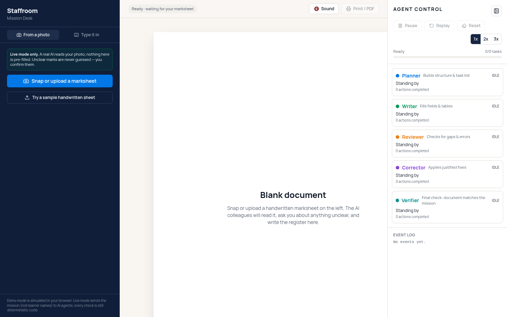
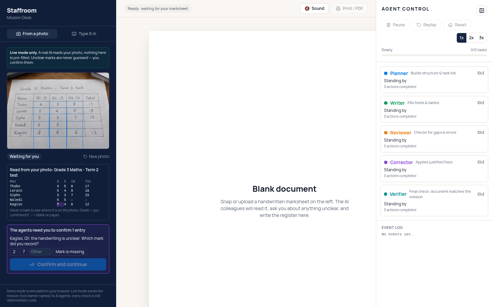
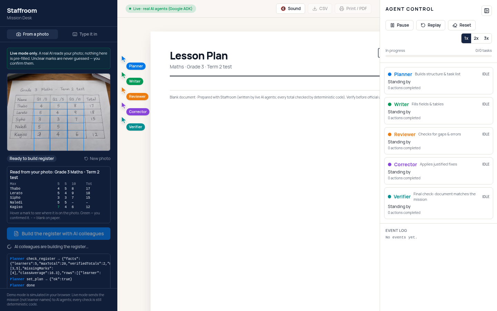
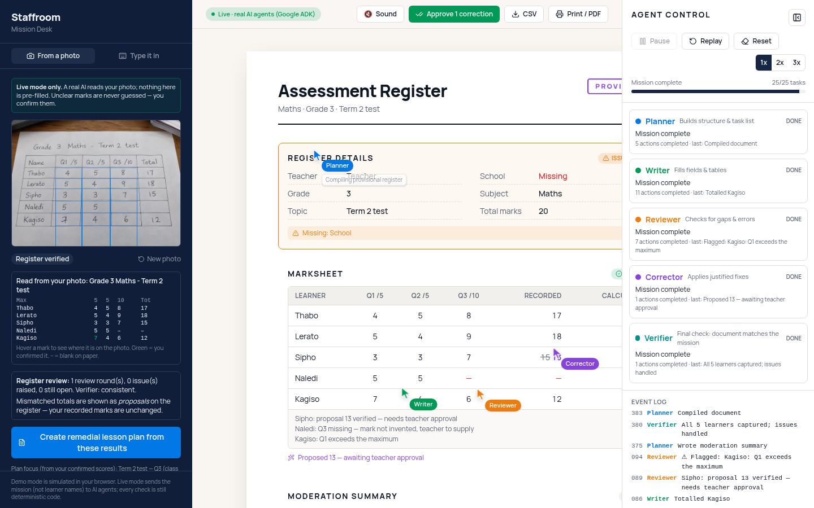
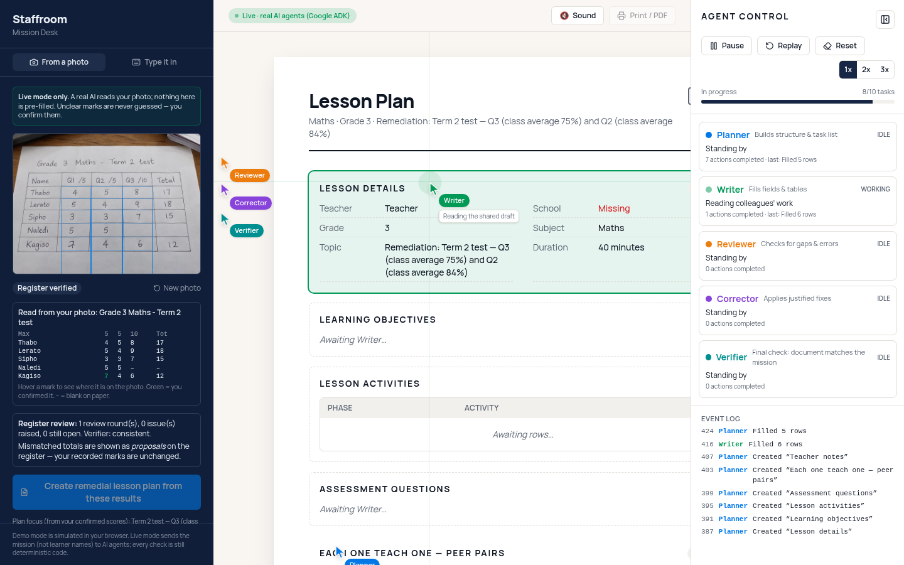
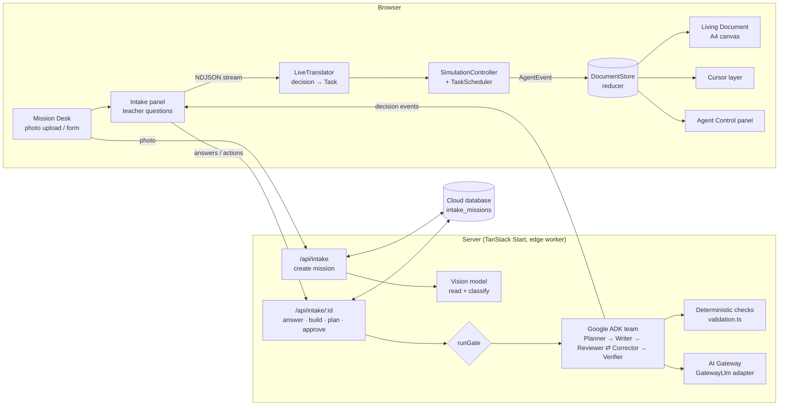
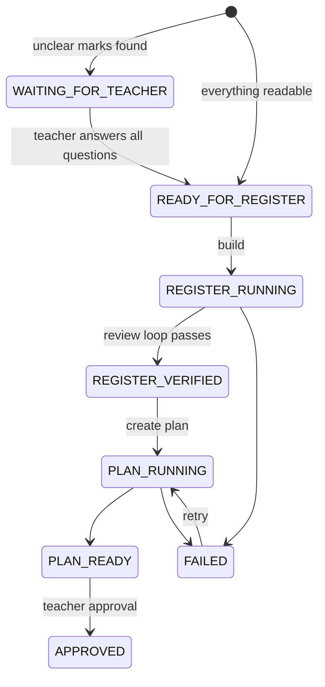
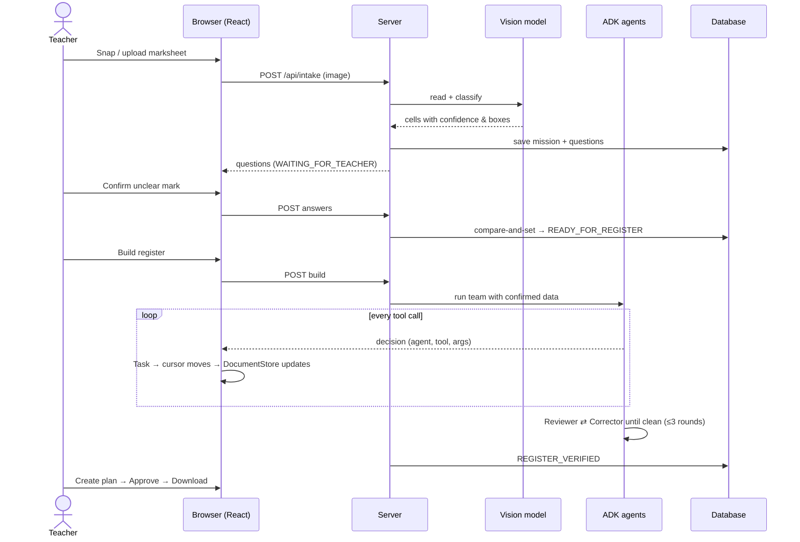

# Staffroom

**Snap a handwritten marksheet. Five AI colleagues turn it into a verified digital register and a remedial lesson plan — in front of you, with every unclear mark confirmed by the teacher.**

Staffroom sells administrative time back to teachers. The agents work visibly on a shared A4 document (each has its own cursor), check their own work against deterministic rules, loop until the checks pass, and stop to ask the teacher whenever something cannot be read with certainty. Nothing unreadable is ever guessed, and teacher-recorded marks are never silently changed.

| 1. Start | 2. Teacher confirms an unclear mark |
| --- | --- |
|  |  |
| **3. Agents build the register live** | **4. Register verified** |
|  |  |
| **5. Remedial lesson plan from the confirmed scores** | |
|  | |

## The workflow

1. **Understand** — a vision model classifies the photo (marksheet, attendance register, other). Non-marksheets and unreadable photos are rejected with a clear message.
2. **Read** — names, per-question marks, maximums and totals are extracted with a confidence score, alternatives and a box on the original photo.
3. **Ask the teacher** — any unclear cell becomes a question. The mission pauses in `WAITING_FOR_TEACHER` and is saved server-side, so it survives reloads and restarts.
4. **Build visibly** — five Google ADK agents build the register; every tool call they make is streamed to the browser and drives a cursor on the document.
5. **Review → correct → re-review** — a bounded loop (max 3 rounds) that exits only when a review leaves no open issues.
6. **Follow-up work** — a remedial lesson plan targeting the weakest questions, with "each one teach one" peer pairs, built from the *verified* scores.
7. **Deliver** — teacher approval, then CSV / Markdown / Print-to-PDF.

## The five colleagues

| Agent | Role | May change |
| --- | --- | --- |
| **Planner** | Structures the document and task list | Layout |
| **Writer** | Fills fields and tables | Text, rows |
| **Reviewer** | Runs deterministic checks (totals, timing, scales) | Nothing — flags issues |
| **Corrector** | Fixes flagged issues | Calculated totals & formatting only. Recorded-mark discrepancies become **proposals** for the teacher |
| **Verifier** | Final audit of the document against the inputs | Nothing — reports consistent / provisional |

> The Verifier guarantees mathematical, structural and input consistency. It does not claim pedagogical or policy correctness.

## Architecture



### Mission lifecycle (server-authoritative)



Every stage change is a compare-and-set on `updated_at`, so a double click or a second tab can never start a second agent run. Agents refuse to start while questions are open.

### What happens in the background vs. the front end



**Front end** — React renders three panels. The `DocumentStore` reducer is the *only* code that changes document state; cursors find their targets through `data-field-id` attributes and re-measure every frame. Sounds are synthesised with Web Audio.

**Back end** — server functions read the photo, own the mission state, run the ADK agents and stream their decisions as NDJSON. Arithmetic (totals, averages, missing marks) is computed by deterministic code; the AI only writes words and decides which tool to call.

## Privacy

- Learner names are not sent to the text agents and are not logged.
- Saved missions (photo + marks) are readable only by the server; they are deleted after 30 days of inactivity.

## Project structure

```text
src/
  routes/
    index.tsx                 Three-panel workspace
    api/intake.ts             Create mission from a photo
    api/intake.$id.ts         Answers, build, plan, approve
    api/adk-mission.ts        Live lesson / report / register stream
  components/staffroom/       MissionDesk, IntakePanel, DocumentCanvas, CursorLayer, AgentCursor, AgentActivityPanel
  staffroom/
    DocumentStore.ts          Reducer — the only writer of document state
    SimulationController.ts   Runs Tasks, emits AgentEvents
    TaskScheduler.ts          Dependencies + per-field locks
    missions.ts               Task lists per mission type
    validation.ts             Deterministic checks (tested)
    adk/                      ADK teams, GatewayLlm adapter, LiveTranslator
    intake/                   Vision read, question logic, mission store
docs/ARCHITECTURE.md          Engine contracts in more depth
```

## Run locally

```sh
bun install
bun run dev      # http://localhost:8080
bunx vitest run  # unit + lifecycle tests
```

Stack: TanStack Start v1, React 19, Vite 7, Tailwind CSS v4, TypeScript, Google ADK (`@google/adk`).

Sample school, teacher and learner data in this repo is fictional.
